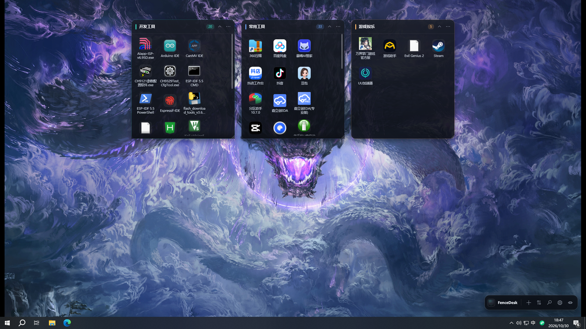
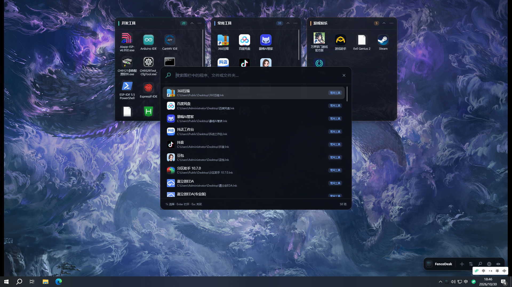
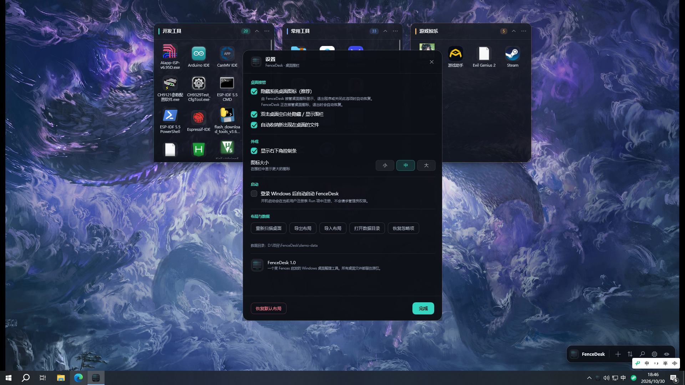

# FenceDesk · 桌面围栏

一个受 **Fences 6** 启发的 Windows 桌面整理工具。它把桌面图标按类型收纳到半透明的「围栏」中，支持自由拖动、缩放、卷起、文件夹门户、搜索、双击桌面隐藏和自动收纳。

> 普通整理只保存「引用」，不会自动移动、重命名或删除你的文件。隐藏围栏会设置 Windows 的 Hidden 属性，不移动、不删除文件；取消隐藏时恢复可见。

当前版本 **1.3.48**：内置 ZIP / 7z / RAR / TAR / GZ / BZ2 / XZ 解压（不再依赖 7-Zip、WinRAR），解压与压缩带进度窗口、可取消，同名文件可逐项选择覆盖 / 跳过 / 两者都保留。



## 界面预览

| 搜索 | 设置 |
| --- | --- |
|  |  |

## 功能

- **自动清理失效项目**：磁盘上删除文件后，围栏会自动移除对应图标，不再长期显示灰色失效项；“刷新围栏”也会立即清理。
- **原桌面切换**：点击右下角控制条的“原桌面”按钮，隐藏围栏并恢复 Windows 桌面图标；再点一次回到围栏。
- **文件操作**：右键图标可直接重命名、删除到回收站、打开属性，不需要先打开文件所在位置；删除前会确认，文件进入回收站而不是永久删除。
- **桌面联动**：主窗口挂载到桌面 `Progman/WorkerW` 层，点击任务栏“显示桌面”后围栏仍然显示；点击围栏不会抢占前台，不会让已打开的应用窗口闪烁。Windows 11 的 `Progman` 没有 DWM 重定向表面，无法承载子窗口，此时自动改用桌面层 z 序：窗口保持顶层，只停在桌面窗口正上方、应用窗口下方。
- **压缩与解压**：右键可把文件/文件夹压缩为 ZIP；解压由程序内置解码器完成，支持 ZIP、7z、RAR、TAR、GZ、TGZ、BZ2、XZ，不需要安装 7-Zip 或 WinRAR。解压和压缩都有进度窗口（百分比、文件计数、速度、当前文件），可随时取消；遇到同名文件会逐项询问「覆盖 / 跳过 / 两者都保留」，并可勾选「对后面所有冲突都使用这个选择」。所有条目先做路径校验，压缩包里的 `../` 不会写到目标目录之外。
- **打开方式**：图片、压缩包及其他文件可右键选择“打开方式…”，调用 Windows 的应用选择器。
- **系统图标**：回收站、此电脑、网络、用户文件夹以独立桌面图标显示在左下角，不放进围栏；右键可打开属性、计算机管理、清空回收站等系统功能。清空回收站后会立即刷新空桶/满桶图标。
- **快捷方式图标**：优先解析快捷方式目标程序的图标，加载失败会自动重试，避免整理后只显示白色占位图标。
- **桌面联动**：点击任务栏右下角的“显示桌面”按钮时，围栏保持显示；如果 Windows 试图最小化围栏窗口，会自动恢复。
- **补收遗漏项目**：设置中可开启“扫描隐藏 / 系统桌面项目”，再点“重新扫描桌面”把隐藏项目补收进围栏。
- **自动分类**：首次启动扫描桌面，按开发工具 / 常用工具 / 通讯聊天 / 办公工具 / 文档资料 / 文件夹 / 游戏娱乐 / 图片素材 / 其他分组建立围栏；新安装应用生成的桌面快捷方式会按名称和目标路径自动归入对应围栏，并复用同名自定义围栏。
- **桌面接管**：可选隐藏 Windows 系统桌面图标，只显示围栏。正常退出、关闭开关或程序异常时自动恢复；隐藏图标时会自动开启开机启动，并有看门狗进程兜底，避免被强杀后桌面全空；不会修改文件。
- **围栏操作**：拖动标题栏移动，拖动右下角缩放，双击标题栏卷起 / 展开，可锁定位置、改变主题色、重命名、排序、删除。
- **实时文件夹门户**：把一个围栏绑定到任意文件夹，围栏会实时显示该文件夹内容；文件夹发生变化时自动刷新。
- **拖放整理**：从资源管理器把文件、快捷方式拖入围栏；也可以在围栏之间拖动图标。
- **搜索**：`Ctrl+Alt+F` 或托盘菜单打开搜索，支持名称、路径、所属围栏的模糊匹配，回车直接打开。
- **快速隐藏**：双击桌面空白处隐藏 / 显示所有围栏，`Ctrl+Alt+D` 同样有效。
- **音乐浮动岛**：桌面精灵是围栏桌面层的一部分，默认在桌面底部中央；无音乐时是圆形小岛，里面两条竖线眼睛跟随鼠标；Windows 媒体会话处于播放状态时才展开为胶囊形，眼睛随节奏跳动，右侧均衡器随峰值起伏。可用鼠标拖动、不置顶、不抢焦点，暂停/停止后自动收回圆形，可在设置中关闭。
- **隐藏围栏**：点击右下角锁图标打开；可设置可选密码。加入其中的文件、文件夹和快捷方式会设置 Hidden 属性，并从其他围栏移除，原生桌面和其他围栏默认不再显示。围栏项目右键“添加到隐藏围栏”，资源管理器文件/文件夹右键“添加隐藏功能”。
- **键盘快捷键**：选中围栏项目后，`Del` 删除到回收站，`Ctrl+C` 复制，`Ctrl+V` 粘贴；仅桌面/围栏在前台时生效，不拦截其他应用。
- **自动收纳**：监控桌面新增文件，自动归入对应类型的围栏；从围栏移除的项目会记住，不会反复出现。监视事件漏掉时，每 60 秒会补扫一次桌面。
- **布局备份**：在设置里导出 / 导入 JSON 布局，或重新扫描桌面重建布局。
- **轻量集成**：系统托盘常驻、开机启动（可选，HKCU 注册表，无需管理员）、单实例运行。

## 使用

| 操作 | 方式 |
| --- | --- |
| 显示 / 隐藏围栏 | 双击桌面空白处，或 `Ctrl+Alt+D` |
| 搜索围栏 | `Ctrl+Alt+F`，或点击右下角控制条的放大镜 |
| 移动围栏 | 拖动围栏标题栏（按住 `Alt` 临时关闭吸附） |
| 缩放围栏 | 拖动围栏右下角 |
| 卷起 / 展开 | 双击标题栏，或点击标题栏右侧的箭头 |
| 围栏菜单 | 标题栏右侧 `···`，或右键标题栏 / 围栏空白处 |
| 刷新围栏 | 围栏菜单 →「刷新围栏」，清理失效项目并重新加载图标 |
| 添加文件 | 从资源管理器直接拖入围栏 |
| 打开项目 | 双击图标；右键可重命名、删除到回收站、打开属性、打开所在位置、复制路径 |
| 压缩 / 解压 | 右键文件 → 压缩此文件（ZIP）；右键压缩包 → 解压缩到当前文件夹 / 解压缩到…，内置支持 ZIP、7z、RAR、TAR、GZ、BZ2、XZ |
| 打开方式 | 右键文件 → 打开方式… |
| 显示桌面 | 点击任务栏最右侧的“显示桌面”，围栏保持显示，并位于应用窗口下方 |
| 原桌面 | 点击控制条的“原桌面”按钮，显示 Windows 桌面图标；再点返回围栏 |
| 系统图标 | 左下角的此电脑 / 回收站 / 网络 / 用户文件夹，点击打开；右键可属性、管理、清空回收站 |
| 新建围栏 | 点击右下角控制条的 `+`，或托盘菜单「新建围栏」 |
| 整理桌面 | 点击控制条的整理按钮，或托盘菜单「整理桌面」 |
| 设置 | 点击控制条的齿轮，或托盘菜单「设置」 |

### 文件夹门户

1. 打开围栏菜单 →「文件夹门户」→「设为文件夹门户…」。
2. 选择一个文件夹。围栏会立即显示其中的文件与子文件夹，并持续监听变化。
3. 门户是**只读视图**：把文件放进真实文件夹才会出现在门户中；「取消文件夹门户」会把它转换回普通围栏，保留当前内容引用。

### 开机启动

设置中勾选「登录 Windows 后自动启动 FenceDesk」。程序会依次尝试：

1. `HKEY_CURRENT_USER\Software\Microsoft\Windows\CurrentVersion\Run`
2. 当前用户的启动文件夹快捷方式
3. 当前用户的登录计划任务

正常桌面会话下通常第一种即可成功。如果程序运行在受限沙箱、安全软件策略或只读环境里，以上位置可能全部被拒绝。此时设置界面会显示原因，并提供：

- **生成启动快捷方式**：在数据目录生成 `FenceDesk.lnk`；
- **打开启动文件夹**：手动把该快捷方式拖入启动文件夹。

这样即使当前进程无法直接写启动项，也能完成配置。移动或重命名程序后需要重新生成一次快捷方式。

## 安装版与开机自启（推荐）

安装包是**单个文件**，不需要解压整个发布目录：

```text
dist\FenceDeskSetup-v1.3.48.exe
```

安装步骤：

1. 双击 `FenceDeskSetup-v1.3.48.exe`。
2. 如果系统启用 UAC，确认管理员授权。
3. 选择安装位置（默认 `C:\Program Files\FenceDesk`），点击“安装”，等进度条走完。
4. 安装程序会：
   - 从内嵌包释放程序文件到安装目录（不经过 `%TEMP%`）；
   - 写入 HKLM 启动项（所有用户登录时启动，运行时使用用户普通权限，不需要管理员）；
   - 创建开始菜单、桌面快捷方式和“应用和功能”卸载项；
   - 如果检测到旧版本装在别的目录（比如换盘前的位置），会提示并自动清理旧目录。
5. 卸载：开始菜单 → FenceDesk → 卸载 FenceDesk，或设置 → 应用 → FenceDesk → 卸载。
   卸载会先调用 `FenceDesk.exe --restore-desktop` 把桌面图标放回来，再删文件。

拿不到管理员权限时会自动降级为**当前用户安装**（`%LOCALAPPDATA%\Programs\FenceDesk`，
启动项写到 HKCU，快捷方式建到当前用户菜单），不会直接失败。

静默安装（脚本/批量）：

```powershell
.\FenceDeskSetup-v1.3.48.exe --silent --dir="C:\Program Files\FenceDesk"
.\FenceDeskSetup-v1.3.48.exe --silent --uninstall
```

> 安装程序本身也必须从**非受限的普通目录**启动。如果安装程序无法写 HKLM，说明整个会话被强制放进了受限沙箱，需要在正常的 Windows 登录会话中执行安装，或者由管理员手动执行下面的命令。

管理员 PowerShell 手动设置 HKLM 启动项：

```powershell
$exe = "C:\Program Files\FenceDesk\FenceDesk.exe"
New-ItemProperty `
  -Path "HKLM:\Software\Microsoft\Windows\CurrentVersion\Run" `
  -Name "FenceDesk" `
  -Value "`"$exe`" --autostart" `
  -PropertyType String -Force
```

删除：

```powershell
Remove-ItemProperty `
  -Path "HKLM:\Software\Microsoft\Windows\CurrentVersion\Run" `
  -Name "FenceDesk" -Force
```

## 数据与恢复

- 默认配置目录：`%APPDATA%\FenceDesk\`
  - `workspace.json`：围栏布局、配色、位置和文件引用。
  - `workspace.backup.json`：上一次成功保存的备份。
  - `fencedesk.log`：错误与诊断日志。
- 如果 AppData 被安全软件、沙箱或权限策略拒绝写入，程序会自动按顺序回退到：
  1. 程序目录下的 `data\`（便携模式）
  2. `%LOCALAPPDATA%\FenceDesk\`
  3. `%TEMP%\FenceDesk\`
- 也可以主动使用便携模式：`FenceDesk.exe --portable`，数据会保存在程序目录的 `data\`。
- 设置里可以「打开数据目录」「导出布局」「导入布局」「恢复默认布局」，并可看到当前实际使用的数据目录。
- 图标接管使用 Explorer 的「显示桌面图标」命令即时切换。正常退出时会检查并恢复。
- 接管桌面图标是「藏起系统图标 + 自己画围栏」，所以程序一旦没起来，桌面就会只剩壁纸。为避免这种情况：
  - 隐藏桌面图标时会**自动开启开机启动**；如果开机启动注册失败（受限权限 + UAC 授权被拒），
    会立刻回滚成显示桌面图标并提示原因。关闭开机启动时也会同时恢复桌面图标。
  - 隐藏图标后会启动一个隐藏的**看门狗进程**（`FenceDesk.exe --watchdog <pid>`），
    它只等待主进程结束；主进程被任务管理器强杀、来不及恢复图标时，由看门狗把图标放回来。
  - 每次启动 FenceDesk 都会做**启动自检**：只要发现桌面图标处于隐藏状态，先无条件恢复，
    再由围栏按设置重新隐藏。
- **桌面全空的应急恢复**：双击运行 `FenceDesk.exe --restore-desktop`（不启动界面），
  会直接恢复系统桌面图标并退出。也可以把它做成桌面快捷方式备用；或者手动在
  桌面右键 →「查看」→ 勾选「显示桌面图标」。

## 系统要求

- Windows 10 19045 或 Windows 11。
- 发布包为 **win-x64 自包含**，不需要安装 .NET 运行时。
- `FenceDesk.exe` 需要和同目录下的 5 个原生 DLL（`D3DCompiler_47_cor3.dll`、`PenImc_cor3.dll`、`PresentationNative_cor3.dll`、`vcruntime140_cor3.dll`、`wpfgfx_cor3.dll`）放在一起使用；已打包为 zip，解压后直接运行。
- 当前版本按**主显示器**的工作区布局；多显示器扩展场景暂未覆盖。

## 构建

需要 .NET 10 SDK（Windows）。

```powershell
dotnet build .\FenceDesk.csproj -c Debug
dotnet run --project .\FenceDesk.csproj
```

生成自包含发布包：

```powershell
.\publish.ps1
```

产物位于 `publish\win-x64\FenceDesk.exe`，压缩包位于 `dist\FenceDesk-v1.3.48-win-x64.zip`。发布目录包含 exe 与 5 个 WPF 原生 DLL，请保持它们在同一目录。

也可以手工执行：

```powershell
dotnet publish .\FenceDesk.csproj -c Release -r win-x64 --self-contained true `
  -p:PublishSingleFile=true -p:IncludeNativeLibrariesForSelfExtract=false `
  -p:EnableCompressionInSingleFile=true -o .\publish\win-x64
```

## 项目结构

```
FenceDesk/
├─ Assets/                 应用图标、Logo
├─ Controls/
│  └─ FenceControl.*       单个围栏的 UI、拖动、缩放、拖放、菜单
├─ Models/
│  ├─ AppModels.cs         围栏/项目/设置/主题色模型
│  ├─ ArchiveModels.cs     进度、冲突、解压选项模型
│  └─ SearchResult.cs      搜索结果模型
├─ Services/
│  ├─ WorkspaceStore.cs    JSON 持久化与备份
│  ├─ DesktopService.cs    桌面扫描、启动、图标接管、开机启动
│  ├─ ArchiveService.cs    内置压缩/解压（SharpCompress）、进度、冲突、取消
│  ├─ CategoryRules.cs     自动分类规则
│  ├─ LayoutService.cs     初始布局、吸附、缩放约束
│  ├─ IconService.cs        Shell 图标提取与缓存
│  ├─ NativeMethods.cs     Win32 / Shell P/Invoke
│  ├─ MouseHook.cs         双击桌面检测
│  ├─ TrayService.cs       托盘图标与菜单
│  └─ LogService.cs        日志
├─ Windows/
│  ├─ ArchiveProgressWindow.*  压缩/解压进度窗口
│  ├─ ArchiveConflictWindow.*  同名文件冲突选择
│  ├─ SearchWindow.*       搜索面板
│  └─ SettingsWindow.*     设置窗口
├─ MainWindow.*            全屏透明桌面层、控制条、悬浮提示、托盘/热键
└─ App.*                   单实例、异常恢复、生命周期
```

## 设计说明

- **全屏透明桌面层**：主窗口覆盖主屏工作区，背景透明，通过 `WM_NCHITTEST → HTTRANSPARENT` 让空白区域点击穿透到桌面；只有围栏和控制条响应鼠标。窗口保持在 Z 序底部，不遮挡普通应用。
- **桌面宿主检测**：挂载前先检查桌面宿主有没有 DWM 重定向表面（`WS_EX_NOREDIRECTIONBITMAP`）。Windows 10 的 `Progman`/`WorkerW` 有，可以直接 `SetParent` 当子窗口；Windows 11 的 `Progman` 没有，子窗口不会被合成，于是改走桌面层 z 序（窗口插入到 `Progman` 正上方），每 650ms 校准一次，Explorer 重启后也能自动恢复。
- **不注入 Explorer**：不使用 DLL 注入或修改系统文件，图标隐藏基于资源管理器自带的切换命令，可恢复。
- **引用式管理**：围栏保存文件路径而不是复制文件；文件夹门户只是实时目录视图。
- **单实例 + 异常恢复**：启动互斥量保证单实例；未处理异常和进程退出钩子都会尝试恢复桌面图标。
- **内置解压**：解压由 [SharpCompress](https://github.com/adamhathcock/sharpcompress)（MIT 许可）在进程内完成，不调用外部 exe，也不落地临时解压目录。ZIP / RAR / 7z / TAR 用归档 API 先读出条目表，因此进度条按「已写字节 / 总字节」计算；`.tar.gz`、`.tar.bz2`、`.tar.xz`、`.gz`、`.bz2`、`.xz` 只能顺序读取，改走 Reader API，`.gz` 会从尾部 4 字节取原始大小当进度基数。没有 UTF-8 标记的 ZIP 文件名按系统 ANSI 代码页解码，中文名不会变成乱码。固实（solid）压缩包在「跳过」某个文件时仍会读完该项的数据，避免后续条目解出错误内容。加密压缩包目前会给出明确提示，暂不支持输入密码。

## 已知限制

- 仅支持 Windows 主显示器布局；多屏、虚拟桌面切换尚未适配。
- 文件夹门户为只读，不支持在门户内直接删除 / 重命名真实文件。
- 系统桌面图标隐藏依赖 Explorer 的桌面视图；如果 Explorer 被重启，可能需要手动在设置里重新切换一次。
- 不替代 Explorer 的桌面右键菜单；空白桌面右键仍由 Windows 处理。
- 解压只能写 ZIP（`.zip`），7z / RAR 因为格式与许可限制只支持解压、不支持创建；加密压缩包暂不支持输入密码。

## License

MIT，见 [LICENSE](LICENSE)。
